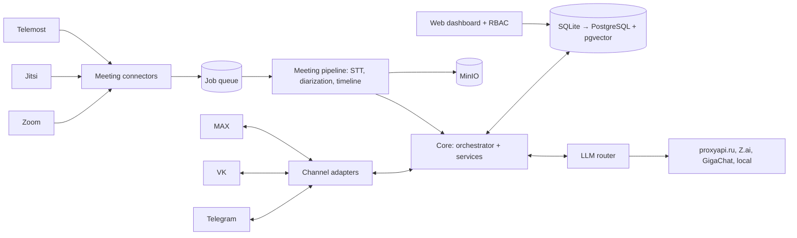

# Team Bot — архитектура проекта

Версия документа: 1.3. Соответствует схеме `architecture_v2_3.drawio`.
Это источник истины для разработки. Если код расходится с документом, сначала обновляется документ (или задаётся вопрос), потом код.

## 1. Назначение и границы

Командный чат-бот, который:

- накапливает идеи команды из чатов и делает по ним саммари и дайджесты;
- разбирает задачи (исполнитель, срок), ведёт список и напоминает о сроках;
- работает в нескольких мессенджерах: Telegram, VK, MAX;
- получает данные со встреч (Zoom, Jitsi Meet, Телемост): запись, чат встречи, участники, и делает по ним саммари с решениями и задачами;
- показывает всё это в веб-дашборде с ролями.

Масштаб на старте: одна команда, архитектура сразу рассчитана на 3–5 команд с изоляцией данных.
Хостинг: локальный сервер. Наружу уходят только запросы к LLM-провайдерам.

Вне рамок первой версии: внешние трекеры (этап 2, см. раздел 12), мобильное приложение, голосовые ответы бота, микросервисы.

## 2. Принятые решения

| Решение | Почему |
|---|---|
| Модульный монолит + порты и адаптеры (гексагональная архитектура) | Один разработчик и одна команда: микросервисы избыточны. Платформы подключаются как заменяемые адаптеры |
| Ядро ничего не знает о Telegram, VK, MAX, Zoom и т.д. | Новая платформа = новый адаптер, без изменений ядра |
| Встречи идут отдельным асинхронным конвейером через очередь | Обработка занимает минуты или часы, её нельзя делать в обработчике сообщения |
| SQLite на этапах M0–M2, затем PostgreSQL + pgvector как единое хранилище (данные, векторы, очередь) | Быстрый старт без инфраструктуры; перенос защищён правилами DB-1…DB-15 и тестами на обеих БД (раздел 8.1) |
| `team_id` во всех командных таблицах; изоляция в репозиториях, с M2.5 ещё и Row-Level Security | Изоляция команд не держится на памяти разработчика: автотест плюс RLS после перехода на PostgreSQL |
| Единая точка доступа к LLM (`LLMRouter`) с политикой по классам данных | Контроль того, что уходит наружу (152-ФЗ), смена провайдера конфигом |
| STT и диаризация локально | Голос и имена не покидают сервер |
| Задачи за интерфейсом `TaskStore` | Внутренний список сейчас, синхронизация с трекерами позже без переделки |
| Мессенджеры по умолчанию через long polling, webhooks опционально | Локальный сервер часто без публичного адреса |

## 3. Технологический стек

| Область | Выбор | Примечание |
|---|---|---|
| Язык | Python 3.12 | Полная типизация, async |
| Менеджер пакетов | uv | |
| Веб и API | FastAPI | webhooks, дашборд, healthcheck |
| Telegram | aiogram 3 | |
| VK | vkbottle | |
| MAX | официальный SDK или maxapi | Проверить актуальность и требования к регистрации бота перед реализацией |
| БД | SQLite (M0–M2), затем PostgreSQL 16 + pgvector (с M2.5) | переход по разделу 8.2; образ `pgvector/pgvector:pg16` |
| ORM и миграции | SQLAlchemy 2 (async) + Alembic (`render_as_batch`) + aiosqlite / asyncpg | выбор БД только через `DATABASE_URL` |
| Планировщик и очередь | M0–M2: APScheduler (только in-memory) за портом `Scheduler`; с M2.5: procrastinate (очередь на Postgres) | Заменимо на arq + Redis, если не подойдёт |
| Объектное хранилище | MinIO (S3-совместимое), с M3 | аудио и записи |
| Речь в текст | faster-whisper, опционально GigaAM | за интерфейсом `SpeechToText` |
| Диаризация | pyannote | модели требуют токен Hugging Face и принятия условий использования |
| LLM-шлюз | LiteLLM как реализация `LLMRouter` | провайдеры: proxyapi.ru (Claude, OpenAI), Z.ai, GigaChat, локальная модель |
| Веб-дашборд (MVP) | FastAPI + Jinja2 + HTMX | вход по сессии, пароли argon2, роли |
| Конфигурация | pydantic-settings, `.env` | секреты только из окружения |
| Логи | structlog | без текстов сообщений и токенов |
| Качество | pytest, pytest-asyncio, ruff, mypy | |
| Развёртывание | docker compose | M0–M2: app; с M2.5: + postgres, worker; с M3: + minio; reverse proxy (Caddy) по необходимости |

## 4. Структура репозитория

```
.
├── ARCHITECTURE.md
├── CURSOR_PROMPT.md
├── README.md                    # подробное описание функционала (раздел 4.1)
├── main.py                      # точка входа проекта (раздел 4.1)
├── pyproject.toml
├── docker-compose.yml
├── .env.example
├── alembic/
├── config/
│   └── llm_routes.yaml
├── docs/adr/                    # записи о принятых решениях (в т.ч. итоги спайков)
├── scripts/                     # migrate_sqlite_to_postgres.py (этап M2.5)
├── src/teambot/
│   ├── core/                    # домен и бизнес-логика, без внешних зависимостей
│   │   ├── events.py            # InboundEvent, OutboundMessage, Capabilities
│   │   ├── models.py            # доменные модели
│   │   ├── ports.py             # Protocol-интерфейсы
│   │   ├── commands.py          # реестр slash-команд бота (раздел 9.1)
│   │   ├── orchestrator.py      # разбор slash-команд, права, маршрутизация событий
│   │   └── services/
│   │       ├── identity.py      # привязка аккаунтов, команды, роли
│   │       ├── ideas.py
│   │       ├── tasks.py
│   │       ├── reminders.py
│   │       ├── summarizer.py
│   │       └── meetings.py
│   ├── adapters/                # вся платформенная специфика только здесь
│   │   ├── channels/            # telegram.py, vk.py, max.py
│   │   ├── meetings/            # zoom.py, jitsi.py, telemost.py, manual_upload.py
│   │   ├── llm/                 # router.py (LiteLLM), локальная модель
│   │   ├── stt/                 # faster_whisper.py, gigaam.py
│   │   ├── diarization/         # pyannote.py
│   │   ├── storage/             # репозитории (SQLAlchemy), dialect.py, s3.py
│   │   ├── scheduler/           # APScheduler (M0–M2), procrastinate (с M2.5)
│   │   └── task_sync/           # yandex_tracker.py, jira.py, bitrix24.py (этап 2)
│   ├── pipeline/                # конвейер встреч и фоновые задачи
│   │   ├── meeting_pipeline.py
│   │   └── jobs.py
│   ├── web/                     # дашборд: routes, templates, auth, RBAC
│   ├── infra/                   # config.py, logging.py, db.py
│   └── bootstrap.py             # единственное место, где адаптеры подключаются к ядру; вызывается из main.py
└── tests/
```

### 4.1 Соглашения по коду и документации

- **Точка входа: `main.py` в корне репозитория.** Это единственный файл, который запускают (`python main.py`). Он читает конфигурацию, вызывает `bootstrap.py` (сборка адаптеров и сервисов) и запускает приложение. Режим выбирается аргументом командной строки: без аргумента запускается основное приложение (адаптеры мессенджеров, API и планировщик в одном процессе); с этапа M2.5 добавляется `python main.py worker` для фонового процесса. Бизнес-логики в `main.py` нет.
- **`README.md`: подробное описание функционала** на русском языке. Разделы: назначение; реализованные возможности по этапам (что работает сейчас, что в планах); таблица команд бота (только реализованные, с описанием и ролью); роли и права; как это работает (кратко: путь сообщения и путь встречи); конфигурация (все переменные `.env` с пояснениями); запуск и тесты; структура проекта; ограничения и известные проблемы; ссылка на `ARCHITECTURE.md`. README обновляется в каждом этапе вместе с кодом, этап не считается завершённым, пока описание не соответствует коду. С этапа M1 тест сверяет команды из реестра `core/commands.py` с таблицей команд в README.
- **Комментарии подробные, на русском языке.** Идентификаторы (переменные, функции, классы, таблицы, поля) остаются английскими. Требования:
  - в начале каждого модуля docstring: назначение, место в архитектуре, ссылка на раздел `ARCHITECTURE.md`;
  - у каждого класса и публичной функции docstring: что делает, аргументы, результат, исключения;
  - комментарии объясняют, зачем сделано именно так (особенно решения по правилам DB-1…DB-15 и ограничения платформ), а не пересказывают код;
  - обходы особенностей внешних API и нетривиальные места помечаются комментарием с причиной;
  - тексты для пользователей бота тоже на русском, в отдельном модуле сообщений.

Пример ожидаемого уровня подробности:

```python
async def add_task(self, ctx: TeamContext, title: str, due_at: datetime | None) -> Task:
    """Создаёт задачу в списке команды.

    Аргументы:
        ctx: контекст команды и пользователя (определяет, в чьём списке создаётся задача).
        title: текст задачи; пустая строка недопустима.
        due_at: срок в UTC или None, если срок не задан.

    Возвращает:
        Созданную задачу с присвоенным идентификатором.

    Исключения:
        PermissionDenied: у пользователя роль ниже member.
    """
    # Права проверяются здесь, а не в адаптере канала: так правило одинаково
    # для Telegram, VK и MAX (см. ARCHITECTURE.md, раздел 9).
    ...
```

## 5. Слои и правила зависимостей



Правила:

1. `core` не импортирует ничего из `adapters`, `web`, `pipeline`, `infra`. Он зависит только от интерфейсов из `core/ports.py`.
2. Названия платформ (`telegram`, `zoom` и т.д.) встречаются только в `adapters/` и в `bootstrap.py`.
3. `adapters` импортируют `core`. Адаптеры друг друга не импортируют.
4. `bootstrap.py` собирает приложение: создаёт адаптеры и передаёт их в сервисы. Вызывается из `main.py`.
5. Любая работа с вводом-выводом асинхронная.

## 6. Ключевые контракты

Типы событий (`core/events.py`):

```python
@dataclass(frozen=True)
class InboundEvent:
    platform: str                   # "telegram" | "vk" | "max"
    chat_id: str
    message_id: str                 # уникален в паре (platform, chat_id) — ключ идемпотентности
    platform_user_id: str
    text: str | None
    attachments: list[Attachment]
    reply_to: str | None
    thread_id: str | None
    ts: datetime                    # UTC
    raw: dict                       # исходный payload, в логи не попадает
    display_name: str | None = None
    chat_title: str | None = None   # имя чата от адаптера, для привязки и /chats

@dataclass(frozen=True)
class OutboundMessage:
    chat_id: str
    text: str
    format: Literal["plain", "markdown"] = "plain"
    buttons: list[Button] = field(default_factory=list)
    reply_to: str | None = None
    attachments: list[Attachment] = field(default_factory=list)

@dataclass(frozen=True)
class Capabilities:                 # что умеет платформа
    buttons: bool
    markdown: bool
    max_text_len: int
    files: bool
    threads: bool
    message_edit: bool
```

Если платформа чего-то не умеет, ядро деградирует мягко: нет кнопок, значит текстовое меню; текст длиннее лимита режется на части.

Интерфейсы (`core/ports.py`), сигнатуры ориентировочные, детали уточняются при реализации:

```python
class ChannelAdapter(Protocol):
    platform: str
    capabilities: Capabilities
    async def start(self, on_event: Callable[[InboundEvent], Awaitable[None]]) -> None: ...
    async def send(self, msg: OutboundMessage) -> None: ...
    async def download(self, attachment: Attachment) -> bytes: ...
    async def publish_commands(self, commands: list[CommandSpec]) -> None: ...
    # публикует меню команд, если платформа это умеет (иначе ничего не делает)

class ChatPresence(Protocol):
    async def is_member(self, chat: ChatRef) -> bool | None: ...
    # True — бот в чате, False — нет, None — этот адаптер чат не обслуживает

class MeetingConnector(Protocol):
    platform: str
    async def handle_webhook(self, request: RawRequest) -> list[MeetingRef]: ...
    async def fetch_artifacts(self, ref: MeetingRef) -> MeetingArtifacts: ...
    # MeetingArtifacts: аудио/видео, сообщения чата встречи, участники,
    # готовый транскрипт (если платформа его даёт)

class SpeechToText(Protocol):
    async def transcribe(self, audio_path: Path, language: str = "ru") -> list[Segment]: ...

class Diarizer(Protocol):
    async def diarize(self, audio_path: Path) -> list[SpeakerTurn]: ...

class LLMClient(Protocol):
    async def complete(self, req: LLMRequest) -> LLMResponse: ...
    # LLMRequest.data_class определяет маршрут (раздел 10)

class TaskStore(Protocol):
    async def create(self, ctx: TeamContext, task: NewTask) -> Task: ...
    async def update(self, ctx: TeamContext, task_id: UUID, patch: TaskPatch) -> Task: ...
    async def list(self, ctx: TeamContext, filt: TaskFilter) -> list[Task]: ...

class TaskSyncAdapter(Protocol):    # этап 2
    async def push(self, task: Task) -> ExternalRef: ...
    async def pull_changes(self, since: datetime) -> list[ExternalChange]: ...

class Scheduler(Protocol):          # M0–M2: APScheduler (in-memory), с M2.5: procrastinate
    async def schedule_once(self, name: str, run_at: datetime, payload: dict) -> str: ...
    async def schedule_cron(self, name: str, cron: str, payload: dict) -> str: ...
    async def cancel(self, job_id: str) -> None: ...

class IdeaIndex(Protocol):          # M1–M2: по нормализованному тексту и тегам, с M2.5: pgvector
    async def index(self, ctx: TeamContext, idea: Idea) -> None: ...
    async def find_similar(self, ctx: TeamContext, text: str, limit: int = 5) -> list[IdeaMatch]: ...
```

`TeamContext` (команда и пользователь) передаётся во все методы, которые работают с данными. Запросов без команды в командных таблицах быть не должно.

## 7. Потоки

### 7.1 Сообщение из чата

1. Адаптер получает событие платформы и приводит его к `InboundEvent`.
2. Дедупликация по `(platform, chat_id, message_id)`; повторное событие игнорируется.
3. Оркестратор определяет пользователя (`identity`) и команду (чат привязан к команде), проверяет права.
4. Slash-команда (реестр в `core/commands.py`, раздел 9.1) или свободный текст направляется в сервис: идеи, задачи, напоминания, саммари.
5. Ответ формируется как `OutboundMessage` и отправляется через тот же адаптер с учётом `Capabilities`.

### 7.2 Встреча

1. Коннектор получает запись, чат и участников (webhook, чтение API или загрузка файла в чат бота).
2. Создаётся задача `process_meeting` в очереди; файлы кладутся в MinIO.
3. Конвейер: STT (если нет готового транскрипта) → диаризация → единый таймлайн (реплики и сообщения чата по времени) → саммаризация через `LLMRouter`.
4. Из саммари извлекаются решения и черновики задач. Задачи создаются после подтверждения человеком в чате.
5. Саммари публикуется в чат команды и сохраняется в БД.
6. Сбой любого шага ретраится с паузой; после лимита встреча получает статус `failed`, администратор видит причину.

Загрузка записи вручную (файл в чат бота) работает для любой платформы и является базовым способом для Телемоста.

## 8. Модель данных

Глобальные таблицы (без `team_id`): `teams`, `users`, `user_identities`.
Все остальные таблицы командные и содержат `team_id`.

| Таблица | Ключевые поля |
|---|---|
| `teams` | id, name |
| `users` | id, display_name |
| `user_identities` | user_id, platform, platform_user_id (уникально по паре) |
| `memberships` | team_id, user_id, role (`owner`, `admin`, `member`, `viewer`) |
| `chats` | team_id, platform, chat_id, title |
| `messages` | team_id, chat_id, platform, message_id, user_id, text, ts, raw (JSON). Уникальность (platform, chat_id, message_id) |
| `ideas` | team_id, author_id, text, text_norm, status, source_message_id |
| `idea_tags` | team_id, idea_id, tag, tag_norm |
| `idea_embeddings` (с M2.5) | team_id, idea_id, embedding (vector), model |
| `tasks` | team_id, title, description, assignee_id, due_at, status, source_type, source_id, created_by |
| `task_links` | task_id, tracker, external_id, synced_at (этап 2) |
| `reminders` | team_id, user_id, task_id, remind_at, status, sent_at |
| `team_settings` | team_id, key, value (JSON): политика данных, срок хранения, расписания дайджестов |
| `meetings` | team_id, platform, external_id, title, started_at, ended_at, host_user_id, status, recording_key, consent_notice_sent |
| `meeting_participants` | meeting_id, display_name, user_id (может быть пустым), joined_at, left_at |
| `meeting_chat_messages` | meeting_id, author_name, ts, offset_sec, text |
| `transcript_segments` | meeting_id, start_sec, end_sec, speaker_label, user_id (может быть пустым), text |
| `summaries` | team_id, scope (`chat`, `meeting`, `period`), meeting_id, content_md, structured (JSON), model, created_at |

Row-Level Security (включается на этапе M2.5; до этого изоляцию обеспечивают репозитории, правило DB-13):

- На командных таблицах включены политики вида `team_id = current_setting('app.current_team')::uuid`.
- Перед работой в транзакции выставляется `SET LOCAL app.current_team = '<uuid>'`.
- Приложение подключается отдельной ролью без `BYPASSRLS` и не владельцем таблиц; на таблицах включён `FORCE ROW LEVEL SECURITY`. Иначе политики не сработают.
- Нужен тест: данные одной команды недоступны из контекста другой.

### 8.1 Правила переносимости БД (SQLite → PostgreSQL)

Обязательны на этапах M0–M2. Цель: чтобы переход на PostgreSQL (этап M2.5) сводился к смене конфигурации, скрипту переноса данных и включению RLS, без переписывания логики. Номера правил используются в ревью («нарушает DB-4»).

**Доступ и SQL**

- **DB-1.** Доступ к БД только через репозитории (`adapters/storage`). Сервисы `core` и `web` не знают о SQLAlchemy и SQL. Так вся специфика БД остаётся в одном месте.
- **DB-2.** Только выражения SQLAlchemy; сырой SQL (`text(...)`) запрещён вне миграций. Диалектный код (настройки подключения, upsert через `ON CONFLICT`) живёт только в `adapters/storage/dialect.py` с ветками для обеих БД; `if sqlite` в другом месте считается нарушением. Выбор БД только через `DATABASE_URL`. Не использовать FTS5, `json_extract`, `GROUP_CONCAT` и подобное.

**Типы данных**

- **DB-3.** Первичные ключи: UUID, создаются приложением (`Uuid`), без AUTOINCREMENT и серверных последовательностей. При переносе не нужно сбрасывать счётчики, конфликты идентификаторов исключены.
- **DB-4.** Время хранится как aware UTC в собственном типе `UtcDateTime` (TypeDecorator: пишет UTC, при чтении возвращает значение с часовым поясом). SQLite теряет часовой пояс, и без этого правила при переносе время сдвигается. Серверные `CURRENT_TIMESTAMP` и `datetime.now()` без часового пояса запрещены.
- **DB-5.** JSON-поля (`JSON`, в PostgreSQL через `with_variant(JSONB)`) только для хранения и чтения целиком: фильтры и сортировка по содержимому запрещены. Массивов нет: теги в таблице `idea_tags`.
- **DB-6.** Перечисления (статусы, роли) хранятся как строка + CHECK, не как нативный ENUM. Длины строк задаются явно (SQLite их не проверяет, PostgreSQL проверяет). Типы значений проверяются на входе репозитория (pydantic), потому что SQLite принимает строку в числовую колонку.
- **DB-7.** Регистр и кириллица: `lower()` и `LIKE` в SQLite корректно работают только с ASCII (без ICU), в PostgreSQL ведут себя иначе. Поэтому поиск и уникальность без учёта регистра идут через нормализованные колонки (`*_norm`, `casefold()` в приложении). Сортировка текста в SQL запрещена: сортировать по времени или id, либо в приложении.

**Целостность и транзакции**

- **DB-8.** На каждом соединении `PRAGMA foreign_keys=ON` (в SQLite выключено по умолчанию). Все ограничения именованные (`naming_convention` в `MetaData`), у связей явный `ON DELETE`.
- **DB-9.** Не полагаться на то, что SQLite пишет последовательно: «проверить, затем вставить» заменяется уникальным ограничением и обработкой конфликта, счётчики меняются атомарным `UPDATE`. Транзакции короткие, без сетевых вызовов (Telegram, LLM) внутри. Настройки SQLite: `journal_mode=WAL`, `busy_timeout`, один процесс записи до M2.5 (бот и планировщик в одном процессе).

**Миграции**

- **DB-10.** Alembic с `render_as_batch=True`. Миграции без диалектного SQL; сначала добавление (таблицы, колонки), удаление и переименование отдельным шагом. В CI на обеих БД: `alembic upgrade head` с нуля и `alembic check` (модели и миграции не расходятся).

**Возможности, которые появятся позже**

- **DB-11.** Поиск по смыслу и дедупликация идей только через порт `IdeaIndex`. На M1–M2 реализация по нормализованному тексту и тегам. Колонки `embedding` в основных таблицах нет, таблица `idea_embeddings` появляется на M2.5.
- **DB-12.** Планировщик только через порт `Scheduler`. Источник истины: таблицы БД (`reminders`, расписания дайджестов в `team_settings`). Планировщик служит «будильником»: при старте перечитывает активные записи и ставит их заново, срабатывание идемпотентно (условный `UPDATE` статуса и `sent_at`, чтобы не отправить дважды). Постоянное хранилище заданий APScheduler не использовать, только in-memory: иначе появится второе хранилище, которое придётся переносить.

**Изоляция команд и тесты**

- **DB-13.** `team_id` NOT NULL с индексом во всех командных таблицах с первого дня. Репозитории командных таблиц наследуют `TeamScopedRepository`, принимают `TeamContext` и сами добавляют фильтр по команде. Автотест перебирает все таблицы с `team_id` из `metadata` и проверяет, что из контекста другой команды данные недоступны: новая таблица подхватывается автоматически. На M2.5 добавляется RLS как второй слой.
- **DB-14.** Каждый PR проходит тесты на обеих БД. Контрактные тесты репозиториев и миграций параметризованы SQLite и PostgreSQL: в CI PostgreSQL поднимается как service container, локально по умолчанию SQLite, PostgreSQL через профиль `postgres` в docker compose. Это главное правило: расхождения диалектов выявляются в день появления, а не при переносе.
- **DB-15.** Подготовка к переносу: серверных default и триггеров нет, все идентификаторы и время создаёт приложение, вне БД хранятся только файлы (в объектном хранилище). Резервная копия SQLite делается через `sqlite3 .backup` или `VACUUM INTO`, а не копированием файла на ходу.

### 8.2 План перехода на PostgreSQL (этап M2.5)

Переход выполняется после M2 либо досрочно, если выполнится любое из условий:

- к системе подключается вторая рабочая группа;
- в БД пишут два и более процесса (отдельный worker, веб-дашборд с записью);
- нужен поиск по смыслу или дедупликация идей по эмбеддингам;
- в логах регулярно появляется `database is locked`.

Шаги:

1. Сделать резервную копию SQLite-файла. Поднять PostgreSQL с pgvector в compose, применить `alembic upgrade head` на пустую БД.
2. Скрипт `scripts/migrate_sqlite_to_postgres.py`: сначала dry-run на копии; перенос в порядке зависимостей внешних ключей в одной транзакции; проверка количества строк по каждой таблице и контрольных сумм ключевых полей. Исходный SQLite-файл остаётся резервной копией.
3. Включить RLS: роль приложения без `BYPASSRLS`, `FORCE ROW LEVEL SECURITY`, `SET LOCAL app.current_team`. Тест изоляции (DB-13) должен проходить и падать при выключенной RLS.
4. Заменить реализацию `Scheduler` на procrastinate; проверить, что напоминания, созданные до перехода, срабатывают.
5. Добавить `idea_embeddings` и реализацию `IdeaIndex` на pgvector; пересчитать эмбеддинги существующих идей.
6. Убрать SQLite из рантайма и тестов, упростить `dialect.py`. С этого момента CI работает только на PostgreSQL.
7. Вынести фоновые процессы в отдельный `worker`.

## 9. Рабочие группы (teams), роли, идентичность

Терминология: «команда» в этом документе означает рабочую группу (team). Команды бота называются slash-командами (раздел 9.1).

- Один человек может иметь несколько идентификаторов (Telegram, VK, MAX) и состоять в нескольких командах.
- Привязка аккаунта: одноразовый код или ссылка-приглашение (`/link`).
- Привязка чата к команде: код привязки, выдаётся администратором (`/bind`).
- Список привязанных чатов: только owner (`/chats`). Канал не умеет перечислить все группы, где состоит бот; в списке только записи привязки и проверка, может ли бот ещё действовать в этих чатах.
- Роли:

| Роль | Права |
|---|---|
| `owner` | всё, включая управление командой и настройками данных |
| `admin` | участники, привязка чатов, настройки команды, просмотр всего |
| `member` | создание и просмотр идей и задач, свои напоминания, просмотр саммари |
| `viewer` | только просмотр |

- Один механизм ролей используется и в боте, и в веб-дашборде.

### 9.1 Slash-команды бота

Уже работающие команды (прототип) сохраняются: имена и смысл не меняются, расширяются только возможности. Новые команды добавляются к ним.

| Команда | Описание в меню | Мин. роль | Этап | Примечание |
|---|---|---|---|---|
| `/start` | Начать | любая | есть | приветствие и справка; со ссылкой-приглашением принимает код привязки (`/start <код>`) |
| `/add` | Добавить задачу | member | есть | позже (M2) разбор исполнителя и срока из текста |
| `/list` | Список задач | viewer | есть | фильтры аргументами: открытые, завершённые, все |
| `/list_csv` | Список в csv | viewer | есть | экспорт; ярлык для `/export` |
| `/list_html` | Список в html | viewer | есть | экспорт; ярлык для `/export` |
| `/summary` | Итоги задач | viewer | есть | итоги по задачам за период (неделя, месяц) |
| `/help` | Справка | любая | M1 | список команд, доступных по роли |
| `/my` | Мои задачи | member | M1 | задачи, назначенные на меня |
| `/done` | Завершить задачу | member | M1 | `/done <номер>` |
| `/edit` | Изменить задачу | member | M1 | текст, исполнитель, срок, статус |
| `/idea` | Добавить идею | member | M1 | |
| `/ideas` | Список идей | viewer | M1 | по тегам и тексту; поиск по смыслу при наличии эмбеддингов (раздел 8) |
| `/link` | Привязать аккаунт | любая | M1 | одноразовый код для связи аккаунтов Telegram, VK, MAX |
| `/bind` | Привязать чат к команде | admin | M1 | код привязки чата |
| `/team` | Моя команда | member | M1 | участники и роли |
| `/invite` | Пригласить в команду | admin | M1 | код или ссылка-приглашение |
| `/role` | Назначить роль | admin | M1 | |
| `/kick` | Исключить из команды | admin | M1 | `/kick <uuid>`; нельзя исключить owner |
| `/unbind` | Отвязать чат от команды | admin | M1 | отвязывает текущий чат, не удаляя группу в мессенджере |
| `/leave` | Выйти из команды | member | M1 | owner выйти не может |
| `/chats` | Чаты команды | owner | M1 | привязанные чаты и доступность бота; непривязанные группы не видны |
| `/remind` | Напоминание | member | M2 | `/remind <номер задачи или текст> <когда>` |
| `/recap` | Саммари чата | member | M2 | за период, по умолчанию за сутки |
| `/digest` | Дайджест идей | member | M2 | за период, также по расписанию |
| `/export` | Экспорт | viewer | M2 | данные (задачи, идеи, саммари) и формат (csv, html, md, pdf) |
| `/settings` | Настройки | member | M2 | личные уведомления; для admin: политика данных и срок хранения |
| `/meeting` | Встречи | member | M3 | список встреч, статус обработки, саммари по номеру; запись можно прислать файлом в чат |
| `/dashboard` | Веб-дашборд | member | M5 | ссылка для входа |
| `/tracker` | Внешние трекеры | admin | M8 | подключение и статус синхронизации |

Меню для BotFather (`/setcommands`) на этапе M1, существующие команды первыми:

```
start - Начать
add - Добавить задачу
list - Список задач
list_csv - Список в csv
list_html - Список в html
summary - Итоги задач
help - Справка
my - Мои задачи
done - Завершить задачу
edit - Изменить задачу
idea - Добавить идею
ideas - Список идей
link - Привязать аккаунт
bind - Привязать чат к команде
team - Моя команда
invite - Пригласить в команду
role - Назначить роль
kick - Исключить из команды
unbind - Отвязать чат от команды
leave - Выйти из команды
chats - Чаты команды
```

Правила:

- Все команды описываются в реестре `core/commands.py`: `CommandSpec(name, description_ru, min_role, stage, handler)`. Меню Telegram и `/help` строятся из реестра, права проверяет оркестратор. Платформенный код команд не содержит.
- Имена команд: латиница, цифры, подчёркивание, до 32 символов (требование меню Telegram).
- Меню публикуется через `ChannelAdapter.publish_commands`. VK и MAX принимают команды как текст; меню у них заменяется кнопками или текстовой справкой в соответствии с `Capabilities`.
- Команда без достаточной роли получает короткий ответ об отсутствии прав.
- Обработка свободного текста без команды (распознавание идей и задач) относится к этапу M2; решение оформить в `docs/adr/`.

## 10. LLM-шлюз и политика данных

Все обращения к LLM идут только через `LLMRouter`. Маршрут определяется классом данных запроса и конфигом `config/llm_routes.yaml`:

```yaml
providers:
  claude_proxy:  { base_url_env: PROXYAPI_BASE_URL, api_key_env: PROXYAPI_KEY, model: <model> }
  openai_proxy:  { base_url_env: PROXYAPI_BASE_URL, api_key_env: PROXYAPI_KEY, model: <model> }
  zai:           { api_key_env: ZAI_API_KEY, model: <model> }
  gigachat:      { api_key_env: GIGACHAT_API_KEY, model: <model> }
  local:         { base_url_env: LOCAL_LLM_URL, model: <model> }
policies:                        # порядок = приоритет и порядок fallback
  general:   [claude_proxy, openai_proxy, zai, gigachat]
  sensitive: [local, gigachat]
data_classes:
  chat_ideas: general
  chat_tasks: general
  digest: general
  meeting_transcript: sensitive  # значение по умолчанию, меняется администратором команды
```

Принципы:

- Точные адреса и имена моделей берутся из документации провайдеров; в коде и репозитории их нет жёстко.
- Доступ к OpenAI и Claude напрямую из России обычно недоступен по региональным ограничениям, поэтому основной путь: proxyapi.ru. Прямой доступ допустим как запасной.
- Класс `sensitive` не должен уходить на зарубежных провайдеров. Это значение по умолчанию подлежит подтверждению владельцем проекта (раздел 16).
- Тексты запросов и ответов в логи не пишутся.

## 11. Платформы встреч

Сведения по документации на октябрь 2026 года; перед реализацией каждого коннектора проверить актуальность.

| Платформа | Что получаем | Как | Условия |
|---|---|---|---|
| Zoom | запись (аудио и видео), транскрипт (VTT), чат встречи (txt и json), участники | вебхук `recording.completed`, затем REST API записей и отчётов по участникам | облачная запись и платный тариф Pro или выше; чат приходит файлом после встречи |
| Jitsi (свой сервер) | запись, чат, события | Jibri (запись), модуль Prosody для журнала чата, Jigasi (транскрипция) при необходимости | сервер собственный; способ захвата чата выбирается спайком (ниже) |
| Телемост | пока ничего автоматически | ручная загрузка записи в чат бота; позже бот-участник | публичное API сводится к управлению встречами и требует Яндекс 360 для бизнеса (его нет) |

Спайк по чату Jitsi (этап M4), результат записать в `docs/adr/`. Варианты:

- серверный модуль Prosody, пишущий сообщения комнат (например, по образцу сообщественного модуля `mod_muc_chat_recording`) с отправкой в бот;
- событие `incomingMessage` iframe API, если встреча открывается внутри нашей веб-страницы;
- бот-участник через headless-браузер (хрупко, запасной вариант).

## 12. Задачи и внешние трекеры

- На этапе 1 задачи живут только в БД, доступ через `TaskStore`. Вся бизнес-логика работает только с этим интерфейсом.
- Своя запись задачи всегда главная. Связи с трекерами хранятся в `task_links`.
- На этапе 2 добавляются адаптеры `TaskSyncAdapter` (Яндекс Трекер, Jira, Bitrix24), двусторонняя синхронизация, перевод статусов между системами.
- Политику конфликтов (кто главнее при расхождении) нужно выбрать до начала этапа 2.
- Входящие изменения из трекеров приходят вебхуками или периодическим опросом.

## 13. Безопасность, соответствие, наблюдаемость

- Секреты только в переменных окружения; в репозитории только `.env.example`.
- Проверка подписей входящих вебхуков (Zoom, Telegram с `secret_token`, остальные по документации).
- Лимиты запросов к платформам, повторы с экспоненциальной паузой.
- В логах нет текстов сообщений, транскриптов, токенов и персональных данных.
- Уведомление об обработке записей закрепляется в чате команды; для Jitsi показывается сообщение при начале записи. Запись и обработка встречи происходят только при наличии уведомления (`consent_notice_sent`).
- Хранение: данные на локальном сервере. Срок хранения исходного аудио задаётся настройкой `RETENTION_AUDIO_DAYS` (значение по умолчанию подлежит подтверждению), транскрипты и саммари хранятся дольше.
- Наблюдаемость: структурные логи, метрики очереди и ошибок адаптеров, алерты на сбои.
- Резервные копии: на M0–M2 ежедневный бэкап SQLite через `sqlite3 .backup` или `VACUUM INTO` (не копированием файла на ходу) и проверка восстановления; с M2.5 ежедневный `pg_dump` и копия MinIO.

## 14. Развёртывание

`docker compose`. На этапах M0–M2: один сервис `app` (API, адаптеры мессенджеров и встроенный планировщик в одном процессе), база SQLite в именованном томе; PostgreSQL доступен профилем `postgres` для тестов. С M2.5: `postgres` и отдельный `worker` (очередь procrastinate); с M3: `minio` и конвейер встреч. Reverse proxy (Caddy) подключается, когда нужны webhooks.

- Для webhooks Zoom, Jitsi и мессенджеров нужен публичный HTTPS-адрес: reverse proxy или небольшой VDS как точка входа. Для мессенджеров достаточно long polling.
- Распознавание речи на CPU медленное. Для длинных встреч нужен GPU; требования к железу уточняются (раздел 16).

## 15. Этапы разработки

Каждый этап завершается рабочим состоянием, проходит тесты и сопровождается обновлённым `README.md`. Следующие этапы заранее не реализуются.

| Этап | Содержание | Критерии приёмки |
|---|---|---|
| M0. Каркас | репозиторий, точка входа `main.py`, начальный `README.md`, docker compose (app), конфиг, БД SQLite и миграции Alembic по правилам 8.1, healthcheck, планировщик с тестовой задачей, CI с тестами на SQLite и PostgreSQL | `docker compose up` и `python main.py` запускают приложение; тесты, ruff и mypy зелёные на обеих БД; автотест изоляции команд (на уровне репозиториев) проходит |
| M1. Ядро и Telegram | события, оркестратор, реестр slash-команд (раздел 9.1), identity, рабочие группы и роли, идеи и задачи, адаптер Telegram | существующие команды (`/start`, `/add`, `/list`, `/list_csv`, `/list_html`, `/summary`) работают как раньше; можно привязать аккаунт и чат, добавить идею и задачу, получить список; повтор события не создаёт дубль |
| M2. LLM, саммари, напоминания | `LLMRouter`, политика данных, саммари чата и дайджест по расписанию, напоминания, команды `/recap`, `/digest`, `/remind`, `/export`, `/settings` | саммари строится через роутер; `sensitive` не уходит на внешние маршруты (тест); напоминание приходит в срок |
| M2.5. Переход на PostgreSQL | план в разделе 8.2: PostgreSQL и pgvector, перенос данных, RLS, procrastinate вместо встроенного планировщика, `IdeaIndex` на pgvector, SQLite убирается | данные перенесены без потерь (счётчики и контрольные суммы совпадают); тест изоляции команд проходит и падает без RLS; созданные ранее напоминания срабатывают; все тесты зелёные на PostgreSQL |
| M3. Встречи (ручная загрузка) | загрузка записи в чат, команда `/meeting`, конвейер STT, диаризация, таймлайн, саммари, черновики задач с подтверждением | запись превращается в саммари с решениями и задачами; сбой шага ретраится |
| M4. Jitsi | спайк по чату, коннектор: запись и чат, участники | после встречи в Jitsi бот публикует саммари с учётом чата |
| M5. Веб-дашборд и роли | вход, роли, страницы встреч, посещаемости, активности чатов, задач | доступ строго по ролям и командам; дашборд читает БД только на чтение |
| M6. VK и MAX | адаптеры VK и MAX на готовой модели события | те же сценарии M1 работают в VK и MAX без изменений ядра |
| M7. Zoom | коннектор: вебхук, запись, транскрипт, чат, участники | после встречи в Zoom бот публикует саммари |
| M8. Внешние трекеры | `TaskSyncAdapter`, `task_links`, политика конфликтов | задача синхронизируется в выбранный трекер и обратно |

Порядок этапов можно менять; зависимости: M2 после M1, M2.5 после M2 (досрочно при условиях из раздела 8.2), M3 после M2.5, M4 и M7 после M3, M8 после M1.

## 16. Открытые вопросы

1. Какой трекер подключать первым на этапе M8 (зависит от того, чем команда пользуется).
2. Подтвердить политику данных: класс `meeting_transcript` по умолчанию `sensitive` (только локальная модель и GigaChat).
3. Подключается ли GigaChat напрямую или через proxyapi.ru; какие модели использовать у каждого провайдера.
4. Требования MAX к регистрации бота (организация, подтверждение).
5. Железо для распознавания речи: есть ли GPU.
6. Срок хранения исходного аудио (`RETENTION_AUDIO_DAYS`).
7. Есть ли у Zoom платный тариф с облачной записью.
8. Способ захвата чата Jitsi (итог спайка на M4).
9. Язык бота: на старте только русский, тексты вынесены в отдельный модуль для будущей локализации.
10. Существующий прототип бота (команды `/start`, `/add`, `/list`, `/list_csv`, `/list_html`, `/summary`): переиспользовать его код или переписать под эту архитектуру, где и в каком формате лежат его данные.
